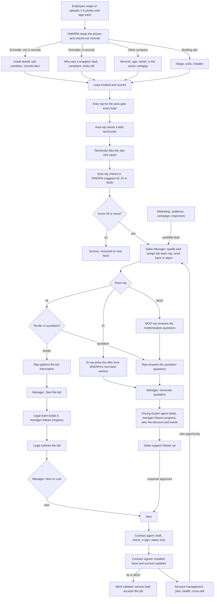
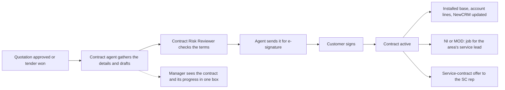
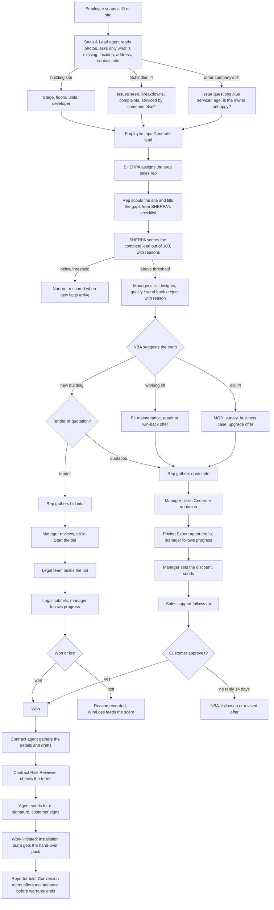

# Snap to deal: the end-to-end flow

This document describes the process from an employee snapping a lift to a signed contract and the installation team's job. For each step it says what the code does and what is still missing.

> **Everything is mocked.** Customers, AI replies, tender documents, emails and the CRM are simulated in the browser (`lib/store.tsx` state, seeded in `lib/data.ts` and `lib/sherpa.ts`). The only real AI call is the optional photo reader `app/api/read/route.ts`, which needs `ANTHROPIC_API_KEY`. Without the key the chat falls back to asking the user. New AI steps follow the same rule: mock by default, real model only if a key is set.

Legend: ✅ built · 🟡 partly built · ❌ missing

> **v2 flow (15 Nov 2026).** Section 9 records the flow agreed for the manager deck ("From a snap to a signed contract") and the decisions behind it. Sections 2 to 7 describe the app as built on that flow.

---

## 1. Two apps, one state

| App | Route | Root | Who |
|---|---|---|---|
| Snap & Lead | `/snap` | `components/apps/SnapRoot.tsx` → `components/reporter/ReporterApp.tsx` | The employee who reports (`alex`, Lukas Meier) |
| SHERPA | `/` | `components/apps/SherpaRoot.tsx` → `components/desk/Desks.tsx` | Sales manager (`marc`), area reps (`laura`, `jan`), team reps (NI, EI, SC, MOD), field technicians, sales support, account manager, service leads, admin |

Both apps share one state (`lib/store.tsx`). A report sent in Snap & Lead becomes an **Item** (a lead, ticket or records task) on the report. Each lead item also becomes an **Opp** (opportunity) in SHERPA through `OP.fromReport` (`lib/sherpa.ts`). The Opp is the single record from lead to won deal. Tender, bid and offer are stages of it.

## 2. The big picture

Everything before the manager's approval (the technician's visit and the site facts) happens at the area rep. SHERPA suggests the installation type from the snap, our records and the visit; the Sales Manager decides it. The NI, EI and MOD reps start only after the manager assigns them, and gather what the installation, the tender or the quotation needs. They never send technicians.

Account-plan leads and marketing leads sent for review skip the visit: the account manager or marketing has already done that work, so they go straight to the Sales Manager.

---

## 3. Step by step

Status of the code on 16 Nov 2026, after the v2 flow (section 9) was built and the earlier flow was removed.

### 3.1 Capture and tag photos

| What | Status | Where |
|---|---|---|
| Live camera, retake, switch camera | ✅ | `components/reporter/CameraPanel.tsx` |
| Upload several files at once, limit of 6 | ✅ | `Assistant.tsx` `onFiles`, `addToStage` |
| Tag per photo (Elevator, Notice board, Building map, or the user's own) | ✅ | `components/reporter/PhotoTag.tsx`, `tagStaged` |
| Tags steer the analysis ("Building map" means location, not a unit) | ✅ | `analyseStaged`, `analyse` |
| Duplicate photo warning; duplicate report credits both reporters | ✅ | `dupMessage` in `Assistant.tsx`; `evaluate()` in `lib/engine.ts` |
| Unsafe lift raises the emergency path before any lead | ✅ | `safetyFlow`, `sendUnsafe` |

### 3.2 Read the photos and check our records

| What | Status | Where |
|---|---|---|
| Photo reader (real Claude call when a key is set, otherwise the preset reading) | ✅ | `app/api/read/route.ts`, `analyse()` |
| Reading card: "Is this correct?" with fixes | ✅ | `analyse`, `fixMenu`, `applyFix` |
| Records lookup against the installed base, presets as demo overrides | ✅ | `buildInput`, `sherpa.assets` |

### 3.3 The conversation branches

The chat asks only what the case needs (`nextQ`, `formFields` in `Assistant.tsx`).

| Case | Asked | Result |
|---|---|---|
| **A. Schindler lift, not in records** | Unit number, how it runs, servicer, lifts, install details (floors, capacity, year, contact) | Records item for the steward; the unit joins the installed base when confirmed. A lead if there is a sales reason |
| **B. Schindler lift, in records** | What we know, then "Why did you snap it?" with follow-ups per reason | Fault → service ticket; ended contract → renewal; old with faults → modernisation |
| **C. Another company's lift** | Servicer, how it runs, lifts, age, who is in charge, open to a call, unhappy with the servicer | Win-back, conversion or modernisation lead |
| **D. Building site** | Stage, units, who is installing, already ordered | New-installation lead |

### 3.4 Lead created, scored and routed

| What | Status | Where |
|---|---|---|
| Lead created in every branch (or info, records, ticket where no lead fits) | ✅ | `evaluate()` in `lib/engine.ts` |
| Score from rules plus history in the area (win rate, earlier leads, key customer) | ✅ | `lead()`, `mods()`, `regionRef` |
| Tier Hot, Warm, Cold or Info; the score shows its reasons | ✅ | `tierOf()`, `Opp.reasons`, hover on the score |
| Every sales lead goes to the **area rep** for its area (Laura Kunz: Zurich City and North; Jan Widmer: Zurich West, Winterthur, outside Zurich), stage **Scout** | ✅ | `areaRepFor()`, `routeItem` in `lib/store.tsx`, `OP.fromReport` |
| SHERPA guesses the team: building site → NI, working lift → EI, old lift → MOD | ✅ | `suggestTeam()` in `lib/sherpa.ts` |
| No area rep covers the area: the Sales Manager gets "Assign an area rep" | ✅ | `OP.fromReport` (`unrouted`), `assign` task |
| Leads from the map and from campaign assignments also go to the area rep | ✅ | `TerritoryMap.tsx`, `SH.apply` (`assign`) |
| "Assign an area rep": SHERPA suggests one by coverage and workload, with **Change** | ✅ | `rankPeople(…, "area")` |

### 3.5 The area rep and the technician

| What | Status | Where |
|---|---|---|
| "Send a technician" task for the area rep, with what the reporter said | ✅ | `scout` task, `ScoutPanel` in `Opps.tsx` |
| The area rep always sends a field technician. SHERPA suggests who from past visits (in the area, on this kind of site) and open work; **Change** shows the others with their numbers | ✅ | `OP.delegateVisit`, `rankPeople`, `PersonPick` |
| Technician's site form: person in charge, condition or site readiness, who decides, timeline, servicer, notes | ✅ | `SitePanel`, `SiteForm`, `OP.siteVisit` |
| Formal tender: the technician is asked for the tender document (**Upload the document**, **Photograph the pages**, or **Not shared yet**). On a tender the form does not show lift and floor counts at all: the tender document has them. The counts only appear for direct quotations, "not known yet" and existing buildings. When the NI rep starts the bid, SHERPA reads it at once, so the rep only answers what it leaves open | ✅ | `SiteVisit.tenderFile`, `OP.qualify` → `OP.tenderDoc` |
| Building sites: the technician asks how the customer will buy, **Formal tender**, **Direct quotation** or **Not known yet**. SHERPA preselects **Formal tender** only on hard evidence (the tender radar found a published tender, or the last project here was a tender) and names it. Otherwise it preselects nothing and says "Ask the person in charge". Shown to the manager as "How they buy" and a reason for NI, and it sets the NI rep's recommended path | ✅ | `SiteVisit.buy`, `suggestBuyPath` |
| Lifts and floors are prefilled, never typed: tender document, our records for that exact building, the federal building register (GWR, floors of existing buildings), else the reporter's estimate. Building sites have no record before the tender, so the technician counts them (or the tender document has them). A mismatch (reporter saw more than our records) is flagged. The technician taps **Looks right**, steps − / +, or counts from a photo (lift lobby, car button panel, site board). The source is saved with each count and shown to the area rep and the manager | ✅ (registers and photo counting mocked) | `buildingFacts`, `CountField`, `SiteVisit.src` |
| The reporter's tracker in Snap & Lead follows the deal: Submitted → With the area rep → Site visit → Manager review → Quotation or bid → Won → Contract → Work initiated (or Lost / Closed), moving (and notifying the reporter) as the deal moves in SHERPA | ✅ | `leadFlow`, `OP.sync`, `leadHooks.progress` |
| A complete report goes straight to the manager: SHERPA scores it and sends it on, and the area rep gets a note. SHERPA holds it as "Check the site visit" only when something is missing, the buy path is not known, the tender document is not shared, or the score is below 45. The area rep never chooses NI, EI or MOD | ✅ | `visitFlags`, `OP.siteVisit`, `OP.scout` |
| The area rep can send the technician again | ✅ | `ScoutPanel` |
| SHERPA rescores with the visit reasons. 45 or more → Sales Manager; below → **Nurture** | ✅ | `scoutReasons`, `reviewMin` (`cfg.tiers.warm`) |
| Nurture list; the manager can pick a lead up with **Review it anyway** | ✅ | `LeadReview.tsx`, `OP.toReview` |
| Area rep has not acted in 48 hours: nudge, then suggest another area rep | ❌ | Only records tasks and marketing leads have a 48-hour check |

### 3.6 The Sales Manager qualifies

| What | Status | Where |
|---|---|---|
| **Lead review** is the manager's start page: scouted leads by tier, plus Being scouted and Nurture tabs | ✅ | `components/desk/LeadReview.tsx` |
| Decision on top: installation type (SHERPA's suggestion marked), **Qualify for …** | ✅ | `ReviewPanel`, `OP.review` |
| No dropdowns in the steps. Every choice is shown as **SHERPA suggests** with its reasons on hover and a **Change** link: installation type, team rep, technician, area rep, customer match, bid and offer discount, contract term, hand-over offer, loss and reject reasons, plan action owner and due date, activity type. Filters and sorting in lists stay as dropdowns | ✅ | `Suggest`, `PersonPick` in `Step.tsx`; `suggestDiscount`, `suggestTerm`, `suggestLossReason`, `suggestRejectReason`, `rankPeople` |
| SHERPA suggests the installation type with its reasons: building site → NI; unit 20+ years old, frequent breakdowns or out of service → MOD; working lift → EI (win-back when the owner is unhappy). The manager can pick another | ✅ | `suggestTeam` (`signals`) |
| No people dropdowns: SHERPA suggests the team rep from history (win rate on this kind of deal, wins in the area, earlier work with the customer, open tasks). Hover the pick for the reasons; **Change** lists the others with their numbers | ✅ | `rankPeople`, `PersonPick` in `Step.tsx` |
| The manager assigns the NI, EI or MOD rep; the deal moves to them | ✅ | `OP.review`, `A.reassign` |
| **Send back** to the area rep with what is missing; **Reject** with a reason that trains the score | ✅ | `OP.sendBack`, `OP.reviewClose` |
| Why this team, SHERPA insight and the site-visit facts below the decision | ✅ | `reviewBrief`, `siteFacts` |

### 3.7 Set up the deal and the customer

| What | Status | Where |
|---|---|---|
| Team rep confirms a new or existing customer (matched by name and place) | ✅ | `DealPanel`, `accountMatches`, `ensureAccountFor` |
| NI: one recommended path, **Formal tender** or **Quotation** (SHERPA suggests, **Change** for the other), and one button: **Start the bid** or **Start the quotation**. The due date comes from the tender document | ✅ | `DealPanel`, `suggestBuyPath`, `OP.setupDeal` |
| EI: pick one of SHERPA's offers (for example 3-year maintenance, 10% off) | ✅ | `dealNbas` |
| MOD: modernisation questions | ✅ | `quoteBrief` |
| Not a fit: close the lead | ✅ | `OP.qualify("notfit")` |

### 3.8 Quotation (NI, EI, MOD)

| What | Status | Where |
|---|---|---|
| Rep answers floors, load, speed, finish or scope, timeline → **Send to Marco** | ✅ | `QuotePanel`, `OP.quoteBrief` |
| Manager clicks **Generate quotation**; the Pricing Expert agent (mocked) prices it from the answers and recent wins | ✅ | `GenQuotePanel`, `OP.genQuote` |
| Manager follows the agent's progress (reading → comparing wins → pricing → writing → ready), mocked over 4 hours; the offer opens when it is ready | ✅ | `PricingPanel`, `PricingStatus`, `OP.pricingReady` (demo) |
| Manager sets the discount and sends with the PDF attached. No draft editing in SHERPA | ✅ | `Offers.tsx`, `emailFor` |
| Sales support follows up: customer approved, reminder, customer said no (with reason) | ✅ | `FollowupPanel`, `SH.chase`, `SH.outcome` |
| Quote idle 14 days: SHERPA suggests a reminder or a revised offer | ✅ | `FollowupPanel` |
| Customer chat with mock replies on the offer | ✅ | `CustomerChat` in `Offers.tsx` |

### 3.9 Tender bid (NI)

| What | Status | Where |
|---|---|---|
| When the technician recorded **Formal tender** or **Direct quotation**, qualifying for NI sets up the deal at once (path, customer match, tender document read); the NI rep has no "Set up the deal" step | ✅ | `OP.review` |
| No bid builder in SHERPA: the legal team builds the bid. The NI rep only gathers information, right on the deal | ✅ | `BidInfoPanel` |
| NI rep: the tender document (already read if the technician uploaded it, otherwise upload it here), answers to what it leaves open, what the customer cares about most, who else is bidding, notes for legal → **Ready for Marco to start the bid**. The document itself is never re-sent: it is already on the deal | ✅ | `OP.tenderDoc`, `OP.submitBid` |
| Manager sees everything gathered, SHERPA's discount, and clicks **Start the bid**, or **Ask {rep} for more** | ✅ | `GenBidPanel`, `bidInfoRows`, `OP.genBid`, `OP.bidChanges` |
| Legal team builds the bid outside SHERPA; the manager follows the progress on the deal (handed over → documents checked → technical compliance → price sheet and papers → ready → submitted), mocked over 3 days | ✅ | `legalSteps`, `LegalStatus`, `OP.legalReady` (demo) |
| The legal team submits the bid in the tender (mocked when their progress completes). The manager only records **Won** or **Lost** (with reason) | ✅ | `BidResultPanel`, `OP.bidSubmitted`, `OP.bidResult` |

### 3.10 Contract and hand-over

Every won deal, new installations included, ends in a contract.

| What | Status | Where |
|---|---|---|
| Contract drafted from the offer, the quotation answers and the tender | ✅ | `CT.draft` in `lib/contracts.ts` |
| Contract and the agent's progress in one box, on the task and on the deal (status only, no draft) | ✅ | `ContractBox` in `Contract.tsx`, `contractAgent` task |
| Check and e-signature by the agent (mock; finishes after 2 days or **Customer signed (demo)**) | ✅ | `CT.agentDone`, `OP.sync` |
| Activation: units, account lines, NewCRM write-back, reporter told | ✅ | `CT.activate` |
| Job for the service lead with the hand-over pack from the signed contract | ✅ | `job` task, `JobPanel`, `HandoverPack` |
| Maintenance offer prompted before the warranty ends | 🟡 | Offered to the SC rep at activation, not timed to the warranty |

**Assumptions:** one contract per won offer. Payment plans are fixed per product: new installation 10% advance, 60% on delivery, 30% on handover; modernisation 30/50/20; service contracts quarterly in advance. Sales support (Anna Fischer) does the commercial and legal check. Customer signing is simulated.

### 3.11 Account management

| What | Status | Where |
|---|---|---|
| Accounts list: health, installed base, lines, contracts ending, pipeline, last activity | ✅ | `components/desk/Accounts.tsx`, `lib/accounts.ts` |
| Account page: units, contracts, deals, contacts, activity, next best actions | ✅ | `Accounts.tsx` |
| Account plan: actions with owners and dates (each becomes a task), white space | ✅ | `accountAction` task |
| Raise an opportunity into Lead review (skips scouting) | ✅ | `AC.raise` |

**Assumptions:** the Account Manager owns key accounts and can see all accounts; reps see the accounts of their own deals and units; the Sales Manager sees all. Health follows the rules in section 8.

### 3.12 Marketing

| What | Status | Where |
|---|---|---|
| Audience builder with a live count | ✅ | `components/desk/Marketing.tsx`, `lib/marketing.ts` |
| SHERPA-drafted message, campaign launch, simulated replies and funnel | ✅ | `Marketing.tsx` |
| Lead scoring; **Send to the Sales Manager** into Lead review (skips scouting) or nurture | ✅ | `MK.toReview` |

**Assumptions:** sending, opens and replies are simulated by a demo button. Marketing leads with a score of 60 or more are offered for review; Marketing decides when to send them.

---

## 4. Task list

Tasks 1–40 (13 Nov 2026) built capture, scoring, Lead review, the technician desk, the tender reader, the quotation questionnaire, contracts, accounts, marketing and the draft editor. Tasks 41–50 (15–16 Nov 2026) moved the app to the v2 flow in section 9.

| # | Task | Status |
|---|---|---|
| 41 | Rep first: route each lead to the area rep of the guessed team, stage **Scout** | ✅ |
| 42 | Scout form for the rep, with delegation to a technician | ✅ |
| 43 | Score after scouting; threshold 45; Nurture list with Review it anyway | ✅ |
| 44 | Manager qualifies with the team choice, send back or reject with a reason | ✅ |
| 45 | Manager generates every quotation (Pricing Expert agent, mocked) and sends it; Sales support follows up | ✅ |
| 46 | Manager generates the bid; mocked legal status; submit and record won or lost | ✅ |
| 47 | Every win ends in a contract; NI and MOD jobs go to the service lead from the signed contract | ✅ |
| 48 | Demo cast, places, map and prices moved to Zurich (CHF) | ✅ |
| 49 | Step panels rebuilt action-first; score details on hover | ✅ |
| 50 | Earlier flow removed: accept, find contact, research, call log, visit, qualify step, sales-support bid checks, customer agreed, approve the win, order | ✅ |
| 51 | 48-hour nudge when an area rep has not acted, then suggest another (G3) | ❌ |
| 52 | Modernisation: Survey Assistant and business case before the quotation | ❌ |
| 53 | Maintenance offer timed to the end of the warranty (G9) | ❌ |
| 54 | One area rep per area gets every lead, always sends a technician, checks the report; SHERPA suggests the installation type and the manager decides it and assigns the team rep | ✅ |

| Persona | What they see now |
|---|---|
| Reporter (Snap & Lead) | Tag-aware photo reading, records lookup, case-specific questions, lead tracker with points at each step |
| Area rep (Laura Kunz, Jan Widmer) | Every new lead in their areas: **Send a technician**. **Check the site visit** only when SHERPA holds the report |
| Field technician (Timo Graf, Andreas Moser) | **My visits**: every visit an area rep sends, with the site form |
| Team rep (NI, EI, MOD) | Leads the manager assigns: set up the deal, answer the quotation questions or gather the bid information. Never sends technicians |
| Sales Manager (Marco Bianchi) | **Lead review**: qualify and assign the team rep, send back to the area rep, or reject. Generates every quotation and bid, follows the legal status, records tender results, follows the Contract agent |
| Sales support (Anna Fischer) | Follows up sent quotations; commercial and legal check on **Contracts** |
| Service lead (Stefan Baumann, Fabian Schmid) | **My jobs**: hand-over pack from the signed contract, accept with a start date and site contact |
| Account Manager (Lena Wolf) | **Accounts**: health, lifts, deals, contracts, white space, account plan; raises leads into Lead review |
| Marketing (Martina Vogel) | **Marketing**: audience, campaign, simulated replies, scored leads into Lead review |
| Admin | Rules, thresholds (the 45 cut-off is the Warm tier), NBA catalogue, approval toggle |

## 5. Decisions

Decisions of 15 and 16 Nov 2026 (section 9.4) replace those of 13 Nov where they differ.

| # | Decision | Since |
|---|---|---|
| 1 | Area rep first, then manager. One area rep per area gets every lead and sends a technician; SHERPA suggests the installation type; the manager qualifies, decides the type, assigns the NI, EI or MOD rep, sends back or rejects | 16 Nov |
| 2 | Threshold 45 (Warm and up). Below it: Nurture, rescored on new facts | 15 Nov |
| 3 | Tender: the manager generates the bid; the legal team works outside SHERPA; the deal shows a mocked status | 15 Nov |
| 4 | Quotations (NI, EI, MOD): the rep gathers, the manager generates and sends, Sales support follows up | 15 Nov |
| 5 | Every won deal ends in a contract, then the installation team gets the hand-over pack | 15 Nov |
| 6 | Demo cast and places in the Zurich region, prices in CHF | 15 Nov |
| 7 | Every lead gets a technician visit, sent by the area rep. Team reps never send technicians; they gather installation, tender and quotation information | 16 Nov |
| 8 | Discount approval above the 10% guideline still applies to offers drafted by reps (for example the after-sale service offer); Admin can switch to "every quotation" | 13 Nov |
| 9 | UI: details open in a side panel, not a page; filters stay behind a Filters button; every step shows its action first | 13 Nov, 16 Nov |

### The flow by step

| # | Who | Step | Task kind | Code |
|---|---|---|---|---|
| 1 | Reporter | Snaps; lead created and routed to the area rep | – | Snap & Lead, `routeItem`, `OP.fromReport` |
| 2 | Area rep | Sends a field technician | `scout` | `OP.delegateVisit` |
| 3 | Field technician | Visits and files the report | `siteVisit` | `OP.siteVisit` |
| 4 | Area rep | Checks the report, sends to the manager; SHERPA suggests the installation type | `scout` | `OP.scout`, `suggestTeam` |
| 5 | Sales Manager | Qualifies and assigns the team rep, sends back or rejects | `review` | `OP.review`, `OP.sendBack`, `OP.reviewClose` |
| 6 | Team rep | Sets up the deal: customer, tender or quotation, or the EI offer | `dealSetup` | `OP.setupDeal` |
| 5q | Team rep | Answers the quotation questions | `quoteBrief` | `OP.quoteBrief` |
| 6q | Sales Manager | Generates the quotation, checks it, sends it | `genQuote`, `revise` | `OP.genQuote`, `SH.send` |
| 7q | Sales support | Follows up until the customer approves or says no | `followup` | `SH.chase`, `SH.outcome` |
| 5t | Team rep | Uploads the tender document, answers the gaps, sends the bid information | `tenderDoc` | `OP.tenderDoc`, `OP.answerGaps`, `OP.submitBid` |
| 6t | Sales Manager | Generates the bid or sends it back | `genBid` | `OP.genBid`, `OP.bidChanges` |
| 7t | Sales Manager | Follows the legal status, submits, records won or lost | `bidResult` | `OP.bidSubmitted`, `OP.bidResult` |
| 8 | Contract agent (Sales Manager follows) | Contract: draft, check, e-sign | `contractAgent` | `lib/contracts.ts` |
| 9 | Service lead | Accepts the job (NI, MOD) | `job` | `OP.acceptJob` |
| after | SC rep, Account manager | Service-contract offer, account actions | `handover`, `accountAction` | `CT.activate`, `OP.offerHandover` |

A lost or rejected deal keeps its reason (`Opp.lostReason`); the next deal at the same customer or place shows "Why we lost here last time" (`lastLoss`).

## 6. Open questions

1. **Modernisation:** survey questions, the business case, and whether it can also go to tender.
2. **48-hour nudge** for leads an area rep has not acted on: how many reminders before suggesting another area rep?
5. **Area rep cover:** two area reps cover the demo region. Does each real area get its own, and who stands in when one is away?
3. **Legal team:** is a status feed from their tool planned, or does the mocked status stay manual?
4. **Customer chat:** inside SHERPA only for now, with mock replies.

## 7. Demo story: one lead from photo to signed contract

This follows the v2 flow (section 9). The full script with what to say is in `demo-storyline.md`. Each person's list is sorted newest first, so the story's lead is always the **top row**. Switch person with **Switch role** (the bar under the phone, or the menu on your avatar). Snap & Lead is at `/snap`, SHERPA is at `/`.

**Before you start:** avatar menu → Demo controls → **Reset demo data**. The cast:

| Person | Role | App |
|---|---|---|
| Lukas Meier | Reporter (any Schindler employee) | Snap & Lead |
| Laura Kunz, Jan Widmer | Area sales reps: every new lead in their areas | SHERPA |
| Timo Graf, Andreas Moser | Field technicians: every site visit | SHERPA (phone) |
| Mia Steiner | Modernisation sales rep (owner after qualifying) | SHERPA |
| Erik Huber, Elias Frei | Existing installation sales reps | SHERPA |
| Sophie Keller | New installation sales rep | SHERPA |
| Marco Bianchi | Sales Manager | SHERPA |
| Anna Fischer | Sales support | SHERPA |
| Stefan Baumann, Fabian Schmid | Service leads (installation team) | SHERPA |
| Lena Wolf | Account manager | SHERPA |
| Martina Vogel | Marketing | SHERPA |

### Chapter 1: the snapped lift becomes a signed modernisation

| # | Who | Do this | You should see |
|---|---|---|---|
| 1 | Lukas Meier, `/snap` | **Take or upload photos**, add any two photos, tag one **Elevator**, tap **Analyse** → **Search for a building** → **Bahnhofplatz Galerie, Block B** → brand **Schindler** → **Yes, looks right** | A short form |
| 2 | Lukas | Unit **61102**, **Minor issues**, **It looks old or worn** → **All of it**, **Ours (Schindler)**, **2 to 4**, contact *Simone Gerber, centre manager* → **Review the lead** → **Create lead** | SHERPA guesses MOD; the lead goes to Laura, the area rep for Zurich City |
| 3 | Laura Kunz | **My work** → top row *Send a technician* → **Send Timo** | The visit goes to Timo |
| 4 | Timo Graf (phone) | **My visits** → top row → met *Simone Gerber*, **Wear and small faults**, **The person I met**, **Now**; lifts flagged (records list 1, Lukas said 2 to 4) → **Photo of the lift lobby**; floors **Looks right** → **File the site-visit report** | Nothing missing: SHERPA scores it and sends it to Marco; Laura gets a note |
| 5 | Marco Bianchi | **Lead review** → top row. Hover the score for its reasons → installation type **Modernisation · SHERPA suggests**, MOD rep **Mia Steiner** → **Qualify for MOD** | The deal moves to Mia: *Set up the deal* |
| 6 | Mia | Top row → **Start the quotation** → **1,000 kg**, **1.75 m/s**, **Controller and drive** → **Send to Marco** | Marco gets *Generate quotation* |
| 7 | Marco | Top row → **Generate quotation** → **Pricing agent finished (demo)** | The progress fills; then **Open OF-…** opens the draft |
| 8 | Marco | **Open OF-…** → discount **12%** → **Mark ready to send** → **Write the email** → **Send to customer** | Anna gets the follow-up |
| 9 | Anna Fischer | Top row *Follow up with …* → **Open OF-…** → answer the customer in the chat → **Customer approved: draft the contract** | Deal in **Contract**; the Contract agent drafts it |
| 10 | Marco | Top row *Contract with the Contract agent* → contract and progress in one box → **Customer signed (demo)** | Contract **Signed**, deal **Won**, job for the service lead |
| 11 | Stefan Baumann | **My jobs** → top row → hand-over pack from the signed contract → **Accept the job** | |
| 12 | Lukas, `/snap` | **My leads** → top row | **Won**, +275 points |

### Chapter 2: the account manager grows the account

| # | Who | Do this | You should see |
|---|---|---|---|
| 1 | Lena Wolf | **Accounts** → *Bahnhofplatz Retail AG* → Next best actions → **Raise for review** on "Win the service on 1 unit serviced by others" | "Sent for review" |
| 2 | Lena | Account plan: add an action for Elias Frei, due in 1 week | Elias gets a task |
| 3 | Marco Bianchi | **Lead review** → top row, "from Account plan". It skips the area rep and the technician because the account manager already knows the account | Qualify as in chapter 1, steps 6 to 15 |

### Chapter 3: marketing brings in a warm lead

| # | Who | Do this | You should see |
|---|---|---|---|
| 1 | Martina Vogel | **Marketing** (opens by default) → **New campaign** | Audience builder with a live count |
| 2 | Martina | Keep the audience, goal **Modernisation** → **Draft the message with SHERPA** → **Save the campaign** | Draft campaign |
| 3 | Martina | **Send to … contacts** → **Simulate a day of replies (demo)** | Funnel fills, scored leads appear |
| 4 | Martina | **Leads** → top row → **Send to the Sales Manager** | "With Marco". Marketing has already qualified it, so it skips the area rep and the technician |
| 5 | Marco Bianchi | **Lead review** → top row is the marketing lead | Qualify as in chapter 1, steps 6 to 15 |

### Chapter 4: a new building becomes a contract

Every step below already has a seeded deal waiting, so you can show any step without doing the earlier ones.

| # | Who | Open | Do this |
|---|---|---|---|
| 1 | Laura Kunz | My work → *Send a technician: Sihl Riverfront* | Shows "Why we lost here last time" → **Send Timo** |
| 1b | Jan Widmer | My work → *Check the site visit: Albisrieden Gardens* | A held report ("nobody knows yet if it goes to tender") → **Send to the Sales Manager** |
| 2 | Timo Graf | My visits → *Schlieren Grand* | The area rep sent him → **File the site-visit report** |
| 3 | Marco Bianchi | Lead review → *Höngg Residenz* | **Qualify for NI** (assigns Sophie), **Send back to …** the area rep, or **Reject** |
| 4 | Marco | Lead review → **Nurture** tab → *Grünau Heights* (35) | **Review it anyway** |
| 5 | Sophie | *Dietikon Crest* | Quotation: answer the questions → **Send to Marco** |
| 6 | Marco | *Glattbrugg Metro Plaza* | **Generate quotation** |
| 7 | Anna Fischer | *Seefeld Tower* (quotation sent) | Follow up → **Customer approved** |
| 8 | Sophie | *Zurich West Tower 4* | Tender: upload the document, answer the gaps → **Ready for Marco to start the bid** |
| 9 | Marco | *Hardbrücke One* | **Start the bid** |
| 10 | Marco | *Stadelhofen Square* | Bid with the legal team: their progress, **Legal submitted the bid (demo)** |
| 11 | Marco | *Wallisellen Signature* | Submitted: **Won** or **Lost** (with a reason) |
| 12 | Marco | *Wollishofen Gateway* | Contract with the Contract agent → **Customer signed (demo)** |
| 13 | Stefan Baumann | **My jobs** → *Wiedikon Meadows* | Read the hand-over pack → **Accept the job** |

### Other paths to show

- **Another company's lift (existing installation):** Story 2 in `demo-storyline.md`. Jan sends Timo to *Altstetten Tech Park, Tower 2*, SHERPA suggests EI, Marco qualifies it and assigns Erik, Erik picks **3-year maintenance, 10% off**, Marco generates and sends it.
- **Full tender, live:** Story 3 in `demo-storyline.md` runs *Sihl Riverfront* from Laura's technician visit to the service lead's job.
- **Lost tender:** the earlier *Sihl Riverfront* deal (closed, lost) keeps its reason for Win/Loss Insights; that is where the "Why we lost here last time" banner comes from.

## 8. How the scores are worked out

Every score has an ⓘ next to it. Click it to see the same breakdown for that lead, lift or account. The rules live in `lib/scores.ts` (and `winChanceWhy` in `lib/sherpa.ts`), so the numbers and the explanations come from the same code.

| Score | Where | Rule |
|---|---|---|
| **Lift health** (0–100) | Portfolio, account lifts | Starts at 100. Minus 1 per year of age over 5 (at most 25), 3 per callback in 90 days (at most 30), 3 per callback more than the 90 days before (at most 15), 4 per out-of-service fault in 90 days (at most 20), 2 per callback in the last 14 days, 10 if a part is discontinued. Below 45 is at risk, 45–69 needs watching, 70+ is good. |
| **Account health** (0–100) | Accounts list and account page | The average health of the account's lifts (70 if none), minus 10 per contract ending within 90 days, minus 2 per fault in 90 days across all lifts (at most 20). Below 50 shows in "Health below 50". |
| **Lead score** (0–100) and tier | Lead review, deal review step | Base points for what was spotted (set in Admin → Rules), plus or minus modifiers (units, building type, condition, age, contact met, key customer), plus History points from our past quotes and customers in the area. Hot 70+, Warm 45–69, Cold 20–44, Info below 20 (thresholds are in Admin). |
| **Win chance** (%) | Offer price check, SHERPA offer options | The share of our past offers for the same product in the same area that were won, counting only offers within 6 points of this discount. If fewer than 3 are that close, all discounts count. |
| **Marketing lead score** (0–100) | Marketing → Leads | Replied 30, fits the audience 10 (or 20 for a lift 20+ years old in a modernisation campaign), existing customer 10, asked for a call or survey 15, otherwise opened 2+ emails 5. 60+ is marked "Ready for sales"; Marketing decides whether to send it to the Sales Manager or nurture it. |

## 9. Target flow v2 (15 Nov 2026)

Source: the manager deck "From a snap to a signed contract" and the SHERPA next-steps pack (personas, NBAs, agent catalogue). The deck follows one new building from a snap to the installation team.

### 9.1 The flow

### 9.2 Gaps added to the brief

| # | Gap | Where |
|---|---|---|
| G1 | Unsafe lift raises an emergency ticket before any lead | Capture |
| G2 | Duplicate building (already a lead or customer): merge and credit both reporters | Capture |
| G3 | No rep covers the area: manager assigns. No action in 48 h: nudge, then suggest reassigning | Assign |
| G4 | Rep can delegate the site visit to a colleague or technician; the lead keeps one owner | Enrich |
| G5 | Below the score threshold: nurture, not delete; rescore on new facts | Score |
| G6 | Manager can send back for more information or reject with a reason; the reason trains the score | Qualify |
| G7 | Quote idle 14 days: follow-up or revised offer | Quotation |
| G8 | Lost bid or quote: reason recorded for Win/Loss Insights | Outcome |
| G9 | NewCRM write-back at every approved step; reporter told of the outcome; maintenance offer before warranty end | After the sale |

### 9.3 What changed from the first flow

| Area | First flow (13 Nov) | v2 (built 16 Nov) | Open question |
|---|---|---|---|
| Order of steps | Manager reviews every lead first, then assigns owner and technician (decision 1) | The area rep gets every lead and sends a technician; the area rep checks the report; SHERPA suggests the team; then score; then the manager qualifies and assigns the team rep (16 Nov) | Q1 |
| Who scouts | Field technician visits (not for NI); NI rep calls or visits | A field technician always visits, sent by the area rep; team reps never send technicians (16 Nov) | Q1 |
| Team choice | Manager picks the owner at review | NBA suggests NI / EI / MOD after qualifying; manager confirms | Q1 |
| Manager list | All leads, by tier | Only leads above a threshold; the rest go to nurture | Q2 |
| Tender | Sales support fills lift details, manager prepares bid, sales support reviews, rep confirms and sends (decision 3) | Rep gathers (no bid builder), manager clicks Start the bid, **legal team** builds it, legal submits it, manager follows progress and marks won or lost | Q3 |
| Quotation | Rep drafts and sends; manager approves only above 10% (decision 4) | Manager clicks Generate quotation, Pricing Expert agent drafts while the manager follows progress, manager sets the discount and sends, sales support follows up | Q4 |
| NI end | Order, not contract (decision 5) | Contract agent drafts the contract, then installation team | Q5 |
| MOD | Quotation path with a survey (task 23 waiting) | MOD team gathers needs, Survey Assistant, Business Case, then quotation path | – |
| Personas | Hyderabad demo cast | Zurich demo cast and places, CHF | Done (decision 6) |

### 9.4 Decisions (15 Nov 2026)

These replace decisions 1, 3, 4 and 5 in section 5 where they differ.

1. **Rep first, then manager.** SHERPA guesses the team from the snap (building site → NI, working lift → EI, old lift → MOD) and assigns that team's area rep. The rep scouts and fills SHERPA's checklist, then submits. SHERPA scores; the manager qualifies, sends back or rejects with a reason, and the NBA confirms or changes the team. *Replaced on 16 Nov by decision 8.*
2. **Threshold 45** (Warm and up), set in Admin. Leads below it go to **Nurture** and are rescored when new facts arrive.
3. **Tender: no bid builder, no Legal login.** The NI rep gathers the information; the manager clicks **Start the bid**; the legal team builds it outside SHERPA. The deal shows their progress (mocked). Legal submits it in the tender; the manager only marks it won or lost.
4. **Quotation (NI, EI, MOD): the manager generates and sends.** The rep gathers the information; the manager clicks **Generate quotation**; the Pricing Expert agent drafts it (mocked); the manager sets the discount and sends it; sales support follows up. Quote idle 14 days: follow-up or revised offer.
5. **Won deals end in a contract**, for new installations too: the Contract agent gathers the details, drafts, has the Contract Risk Reviewer check it and sends it for e-signature; the manager only sees the contract and its progress (mocked), then the installation team gets the hand-over pack.
6. **Demo cast and places move to Europe** (European names, Zurich-area places and map).
7. **Technician visits are optional:** the rep scouts by default and can delegate the visit to a field technician. *Replaced on 16 Nov by decision 8.*
8. **One area rep per area (16 Nov 2026).** Every lead goes to the area rep, who always sends a field technician, checks the report. SHERPA suggests NI, EI or MOD; the manager decides. Everything before the manager's approval happens there. The manager qualifies and assigns the team rep. NI, EI and MOD reps never send technicians; they gather installation, tender and quotation information. This replaces decisions 1 and 7 where they differ.
9. **SHERPA suggests the installation type (16 Nov 2026).** The area rep does not choose NI, EI or MOD. SHERPA suggests it from the snap, our records and the technician's visit, shows its reasons to the Sales Manager, and the manager decides when qualifying.
